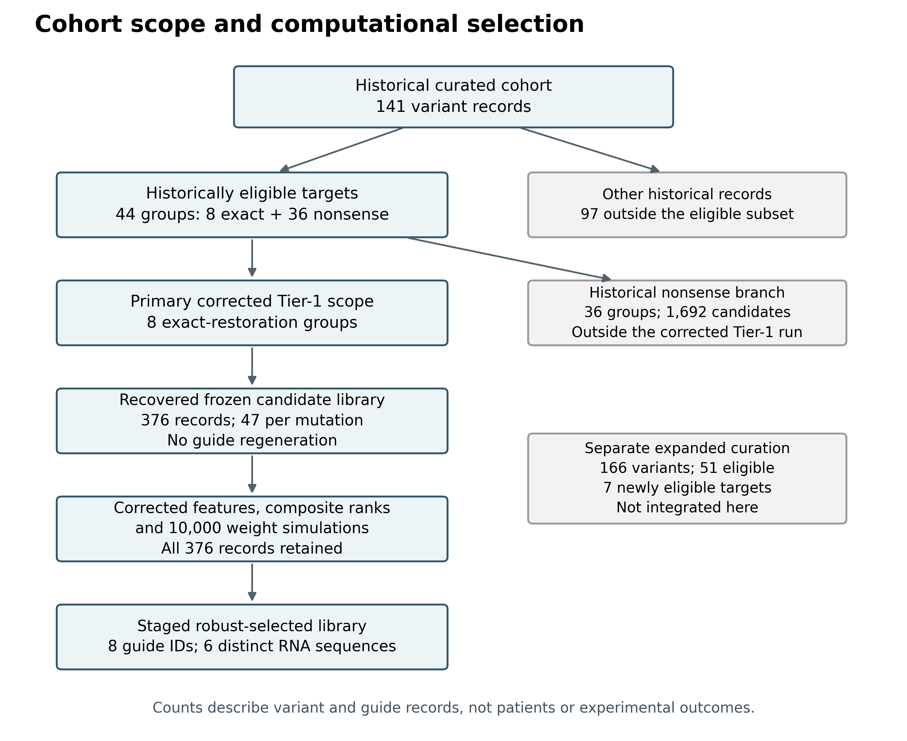
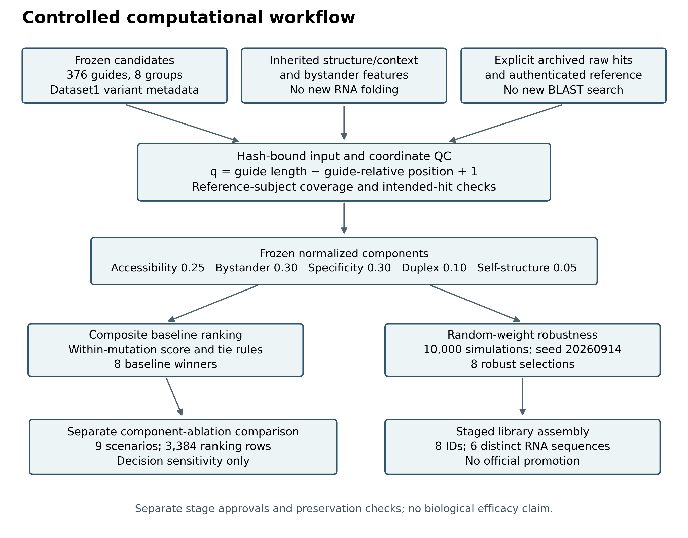
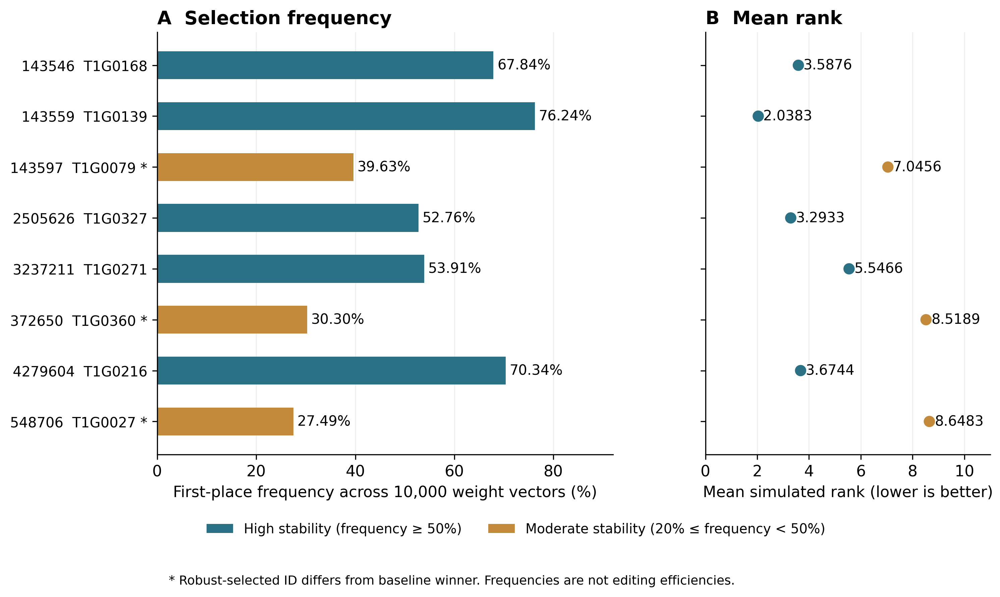
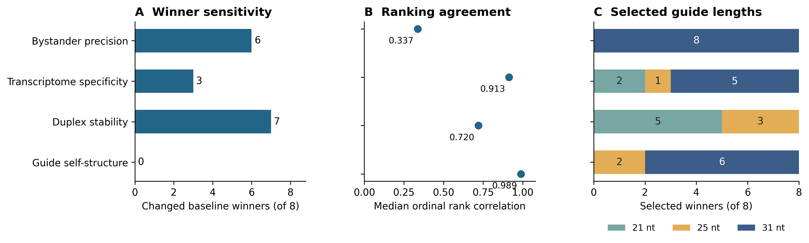

# MECP2-ADAR Computational Guide Prioritization

Computational prioritization and sensitivity analysis of **376 frozen antisense RNA guide records across eight MECP2 exact-restoration target groups**. The staged library contains **eight selected guide IDs representing six distinct RNA sequences**.

Repository: https://github.com/reshma-rt/MECP2-GUIDE

**Research scope:** these are computational target-binding candidates with a deliberate A:C mismatch. Editing efficacy, protein rescue, therapeutic benefit and clinical readiness have not been demonstrated. A complete experimentally established editor/recruitment architecture is not specified.

## Study scope

| Dataset or analysis | Scope | Interpretation |
|---|---|---|
| Historical curated cohort | 141 variant records | Frozen curation context; not a complete current ClinVar census |
| Historical eligible targets | 44 groups; 2,068 guides | Eight exact-restoration and 36 nonsense-suppression targets |
| Primary corrected analysis | **Eight groups; 376 guides** | Completed controlled Tier-1 analysis represented here |
| Historical nonsense branch | 36 groups; 1,692 guides | Outside the corrected Tier-1 run |
| Expanded reference-curation milestone | 166 variants; 51 eligible | Seven additional eligible targets were not integrated into this run |

Do not describe all 2,068 historical guides as receiving the corrected workflow. The original Stage2A generator was not found within the documented search scope; this analysis uses the recovered frozen guide library rather than claiming reproduction of its original generation.

## Workflow

1. Bind frozen candidate, context/structure and bystander tables to explicit input identities.
2. Validate guide identities and guide-relative coordinates.
3. Reconstruct and rescore full-length windows from a selected existing raw BLAST-hit input; annotate editable-A candidates using the corrected register.
4. Calculate five-component composite scores and ranks separately within each target group.
5. Evaluate 10,000 random-weight simulations and six predefined sensitivity scenarios.
6. Characterize component dependence using nine ablation/comparison scenarios.
7. Assemble one robustness-selected guide record per target in a separate staged library.

The controlled feature stage reused existing BLAST anchors and inherited structural/bystander values. It did **not** launch new BLAST searches, regenerate guides or repeat RNA folding. Assembly did not promote outputs into the official project.

## Candidate and coordinate conventions

Each target has 47 designs: 11 of length 21 nt, 15 of length 25 nt and 21 of length 31 nt. Sequences are recorded 5′ to 3′. For guide length `L` and explicit guide-relative target position `g`, the catalytic position in the target-oriented query is:

```text
q = L - g + 1
```

The explicit target-segment position must agree. A legacy transcript/CDS coordinate must never be substituted for `g`.

Example: T1G0330 has `L=21`, `g=6`, hence `q=16`. For G7E on NM_004992.4, c.20 maps to full-mRNA position 232 because the CDS starts at 213. Its stored 201-nt reference context was confirmed against positions 132–332. This resolves that context-mapping concern, not historical Stage2B input consumption.

## Ranking methodology

```text
Composite score = 100 × (0.25 A + 0.30 B + 0.30 S + 0.10 D + 0.05 G)
```

| Component | Definition | Weight |
|---|---|---:|
| A | Mean of Target_A_unpaired_probability and Target_A_5nt_mean_unpaired_probability | 0.25 |
| B | Bystander_precision_score_0_1; inherited heuristic | 0.30 |
| S | Fullwindow_GuideAware_transcriptome_specificity_score_0_1 | 0.30 |
| D | Cohort min–max duplex-energy score; more-negative energy favored | 0.10 |
| G | Cohort min–max guide self-folding score; less-negative energy favored | 0.05 |

For duplex energy E, `D=(Emax-E)/(Emax-Emin)`. For guide energy E, `G=(E-Emin)/(Emax-Emin)`. Constant-energy conventions are D=0 and G=1. Recorded cohort ranges are −71.9 to −21.6 kcal/mol for duplex energy and −14.7 to 0 kcal/mol for guide energy.

Specificity uses cohort-normalized raw risk. The raw risk combines editable-A window contributions `1/(1+mismatch_count)` with additional non-target-window penalties of 0.25, 0.15, 0.08 and 0.04 for zero through three mismatches. Specificity is one minus min–max normalized risk; a constant raw-risk cohort receives specificity 1. See [methods](docs/METHODS.md) and the processor source for implementation details.

Baseline ranking orders composite score descending, editable-A off-target count ascending, then Guide_ID lexically. No global rank is claimed. Accessibility is constant within each target group and therefore cannot distinguish its 47 guides. All weights and risk features are heuristic; scores are not editing probabilities.

## Robustness methodology

- **10,000 simulations; seed 20260914.**
- Five independent exponential(rate=1) draws are normalized per simulation, giving Dirichlet(1,1,1,1,1) weights. The same vector is applied across target groups.
- Frozen component values are reused without new energy normalization.
- Simulation and predefined-scenario score ties resolve by lexical Guide_ID, differing from the baseline secondary tie rule.
- Win frequency is first-place count / 10,000; mean rank is rank sum / 10,000.
- High stability: frequency ≥0.50. Moderate: ≥0.20 and <0.50. Otherwise: weight-sensitive.
- Robust winner: frequency descending, mean rank ascending, baseline score descending, then Guide_ID.

Predefined vectors in A/B/S/D/G order: baseline (.25/.30/.30/.10/.05), equal (.20/.20/.20/.20/.20), specificity-heavy (.15/.20/.45/.10/.10), bystander-heavy (.15/.45/.20/.10/.10), accessibility-heavy (.45/.20/.20/.10/.05), and structure-heavy (.15/.20/.20/.25/.20).

Frequencies describe selection under the specified computational weight distribution—not biological success probabilities.

## Main results

| VariationID | Baseline winner | Robust winner | Win frequency | Mean rank | Stability |
|---|---|---|---:|---:|---|
| 143546 | T1G0168 | T1G0168 | 67.84% | 3.5876 | High |
| 143559 | T1G0139 | T1G0139 | 76.24% | 2.0383 | High |
| 143597 | T1G0094 | T1G0079 | 39.63% | 7.0456 | Moderate |
| 2505626 | T1G0327 | T1G0327 | 52.76% | 3.2933 | High |
| 3237211 | T1G0271 | T1G0271 | 53.91% | 5.5466 | High |
| 372650 | T1G0347 | T1G0360 | 30.30% | 8.5189 | Moderate |
| 4279604 | T1G0216 | T1G0216 | 70.34% | 3.6744 | High |
| 548706 | T1G0012 | T1G0027 | 27.49% | 8.6483 | Moderate |

Five selections match baseline winners; three differ. All eight robust-selected guides are 31 nt. Equal-weight winners match the robust-selected set in this cohort. T1G0327, T1G0271 and T1G0216 share an RNA sequence, but retain different variant/target-register associations. Do not collapse their records or call the eight IDs eight distinct sequences.

| Guide length | Candidates | Baseline winners | Robust winners |
|---|---:|---:|---:|
| 21 nt | 88 | 0 | 0 |
| 25 nt | 120 | 2 | 0 |
| 31 nt | 168 | 6 | 8 |

This is a selection pattern within the framework, not evidence that longer guides edit better.

### Full-window checks

The selected raw input contained 659,348 rows. All 34,315 required subject identifiers were present. The controlled run retained 376 guide rows, recovered exact intended hits for all 376 guides, and produced 6,782 reconstructed-hit rows.

The earlier archive contained 6,359 windows: 6,344 were shared, 438 new-only and 15 old-only, for a net difference of 423. Both input-anchor selection and register handling contributed; the entire difference must not be attributed solely to coordinate correction. Historical editable-A reclassifications are not experimentally confirmed false positives.

### Component ablation

Nine scenarios produced 3,384 ranking rows and 72 winners. Removing a component proportionally renormalizes the remaining original weights. Common tie handling is score descending, editable-A count ascending, then Guide_ID.

| Removed component | Baseline winners changed | Median ordinal-rank correlation | Mean top-five Jaccard |
|---|---:|---:|---:|
| Bystander precision | 6/8 | 0.337 | 0.258 |
| Specificity | 3/8 | 0.913 | 0.681 |
| Duplex stability | 7/8 | 0.720 | 0.334 |
| Guide self-structure | 0/8 | 0.989 | 0.720 |

These are internal decision-sensitivity comparisons, not causal or experimentally established feature importance. Specificity-only top scores tie across multiple candidates, making secondary tie rules consequential.

## Folder structure

The tree below lists files tracked in the inspected repository commit. Local temporary files and generated test-evidence directories are omitted.

```text
MECP2-GUIDE/
├── .gitignore
├── PUBLIC_EXPORTS.json
├── README.md
├── code/
│   ├── ablation/
│   │   ├── OUTPUT_COLUMNS.json
│   │   ├── ablation_io.py
│   │   ├── mecp2_ablation.py
│   │   ├── run_tests.py
│   │   ├── schema.json
│   │   └── test_ablation.py
│   ├── assembly/
│   │   ├── assembly_io.py
│   │   ├── input_schema.json
│   │   ├── mecp2_tier1_assembly.py
│   │   ├── run_tests.py
│   │   └── test_assembly.py
│   ├── features/
│   │   ├── mecp2_launcher.py
│   │   ├── mecp2_processor_bridge.py
│   │   ├── stage2D_v4_tier1_fullwindow_ACCESSION_FIXED_missing_reference_safeguard_proposed.py
│   │   ├── stage2d_reference_safeguard.py
│   │   ├── test_launcher.py
│   │   └── test_sources/
│   │       ├── processor.py
│   │       └── stage2d_reference_safeguard.py
│   ├── ranking/
│   │   ├── mecp2_ranking_adapter.py
│   │   ├── run_tests.py
│   │   ├── schema_contract.json
│   │   ├── source_snapshots/
│   │   │   ├── MECP2_Feature_Output_Verification.md
│   │   │   ├── stage2E_v2_tier1_harmonized_ranking.py
│   │   │   └── stage2F_v2_tier1_harmonized_sensitivity.py
│   │   └── test_ranking_adapter.py
│   └── robustness/
│       ├── mecp2_robustness_adapter.py
│       ├── robustness_core.py
│       ├── robustness_io.py
│       ├── run_tests.py
│       ├── schema_contract.json
│       ├── source_snapshots/
│       │   ├── stage2E_v2_tier1_harmonized_ranking.py
│       │   └── stage2F_v2_tier1_harmonized_sensitivity.py
│       ├── synthetic_fixtures.py
│       └── test_robustness_adapter.py
├── data/
│   └── frozen_inputs/
│       ├── MECP2_ADAR_Dataset2_Tier1_candidate_guides.csv
│       ├── MECP2_ADAR_Dataset2_Tier1_stage2B_structure.csv
│       ├── MECP2_ADAR_Dataset2_Tier1_stage2C_bystander.csv
│       └── mecp2_ADAR_Dataset1_FROZEN_after_live_ClinVar_recheck.csv
├── docs/
│   ├── DATA_AND_REUSE.md
│   ├── LICENSE_DECISION.md
│   ├── METHODS.md
│   └── TEST_SCOPE.md
├── figures/
│   ├── FIGURE_CAPTIONS.md
│   ├── Figure_Ablation.pdf
│   ├── Figure_Ablation.png
│   ├── Figure_Ablation.svg
│   ├── Figure_Analysis_Workflow.pdf
│   ├── Figure_Analysis_Workflow.png
│   ├── Figure_Analysis_Workflow.svg
│   ├── Figure_Cohort_Flow.pdf
│   ├── Figure_Cohort_Flow.png
│   ├── Figure_Cohort_Flow.svg
│   ├── Figure_Robust_Win_Frequency.pdf
│   ├── Figure_Robust_Win_Frequency.png
│   └── Figure_Robust_Win_Frequency.svg
├── requirements.txt
└── results/
    ├── ablation/
    │   ├── comparison_rankings.csv
    │   ├── comparison_winners.csv
    │   ├── mutation_comparisons.csv
    │   ├── scenario_definitions.json
    │   └── scenario_summary.csv
    ├── assembly/
    │   ├── assembly_qc.json
    │   └── tier1_candidate_library_PUBLIC.csv
    ├── features/
    │   ├── MECP2_ADAR_Dataset2_Tier1_stage2D_v3_fullwindow_offtarget.csv
    │   ├── MECP2_ADAR_Dataset2_Tier1_stage2D_v3_fullwindow_summary.csv
    │   ├── stage2D_v3_reconstructed_hits.tsv
    │   ├── stage2D_v4_safeguard_run_status.json
    │   └── stage2D_v4_safeguard_run_summary.csv
    ├── ranking/
    │   ├── mutation_summary.csv
    │   ├── normalization.json
    │   ├── ranked.csv
    │   └── top_guides.csv
    └── robustness/
        ├── events.jsonl
        ├── mutation_summary.csv
        ├── robust_top_guides.csv
        ├── scenarios.csv
        ├── sensitivity_all_guides.csv
        └── simulation_qc.json
```

## Repository contents

| Directory | Contents |
|---|---|
| [code/features](code/features) | Launcher, bridge, corrected processor proposal, reference safeguard and feature tests |
| [code/ranking](code/ranking) | Composite-ranking adapter, schema, tests and historical source snapshots |
| [code/robustness](code/robustness) | Robustness adapter, core, input contracts and synthetic tests |
| [code/assembly](code/assembly) | Separate library-assembly adapter and tests |
| [code/ablation](code/ablation) | Component-comparison adapter and tests |
| [data/frozen_inputs](data/frozen_inputs) | Recovered cohort, candidate, structure and bystander input tables |
| [results/features](results/features) | Corrected full-window tables and safeguard outputs |
| [results/ranking](results/ranking) | 376 ranked guides, eight baseline winners and normalization records |
| [results/robustness](results/robustness) | 376 sensitivity rows, eight robust winners, 48 scenario rows and QC/event records |
| [results/assembly](results/assembly) | Eight-entry public library projection and assembly QC |
| [results/ablation](results/ablation) | Scenario rankings, winners and summaries |
| [figures](figures) | Cohort, workflow, robustness and ablation figures in PNG/PDF/SVG |
| [docs](docs) | Methods, reuse terms, test scope and licensing decisions |

Start with [the public candidate library](results/assembly/tier1_candidate_library_PUBLIC.csv), [robust winners](results/robustness/robust_top_guides.csv), [ranked guides](results/ranking/ranked.csv), and [ablation summary](results/ablation/scenario_summary.csv).

## Synthetic test verification

A fresh GitHub clone of commit **2c6de83101412fe29373cf52944c653a24db75b0** was tested on **28 October 2026**, using **Python 3.12.14 on Linux**:

| Suite | Passed | Failures | Errors | Skipped |
|---|---:|---:|---:|---:|
| Ranking | 43 | 0 | 0 | 0 |
| Robustness | 52 | 0 | 0 | 0 |
| Assembly | 40 | 0 | 0 | 0 |
| Ablation | 32 | 0 | 0 | 0 |
| **Total** | **167** | **0** | **0** | **0** |

All four runners returned exit code 0; tracked files remained unchanged. Test evidence was generated in the isolated clone, not committed to the remote. This establishes that these suites passed at that commit; it does not automatically certify later code revisions.

From a fresh clone, run each command separately and stop if its exit code is nonzero:

```bash
git clone https://github.com/reshma-rt/MECP2-GUIDE.git
cd MECP2-GUIDE
python -I -B code/ranking/run_tests.py
python -I -B code/robustness/run_tests.py
python -I -B code/assembly/run_tests.py
python -I -B code/ablation/run_tests.py
```

Each runner writes a fresh `test_evidence_*` directory beside itself. Tests use synthetic fixtures; the robustness suite includes a synthetic 10,000-simulation fixture, not real-cohort recalculation. They do not establish biological validity.

The feature-launcher suite was **not executed in this clean-clone check**. Windows production-host enforcement and a complete real-data rerun were also not tested. Historical snapshots contain local paths and must not be launched directly as production scripts.

## Figures









See [figure captions](figures/FIGURE_CAPTIONS.md). Figure order in a manuscript may be harmonized separately.
